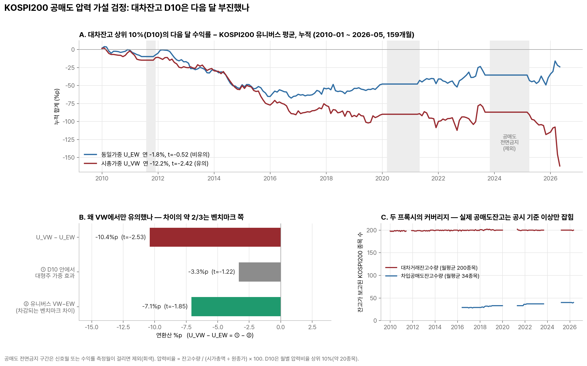
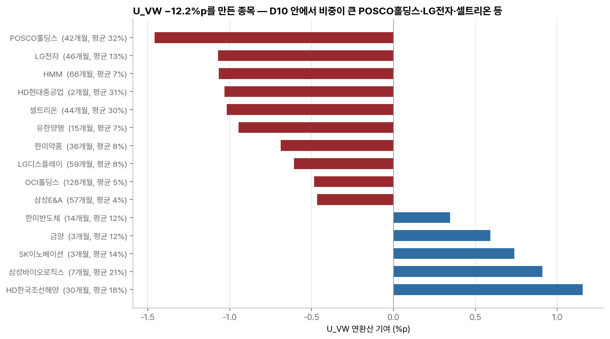
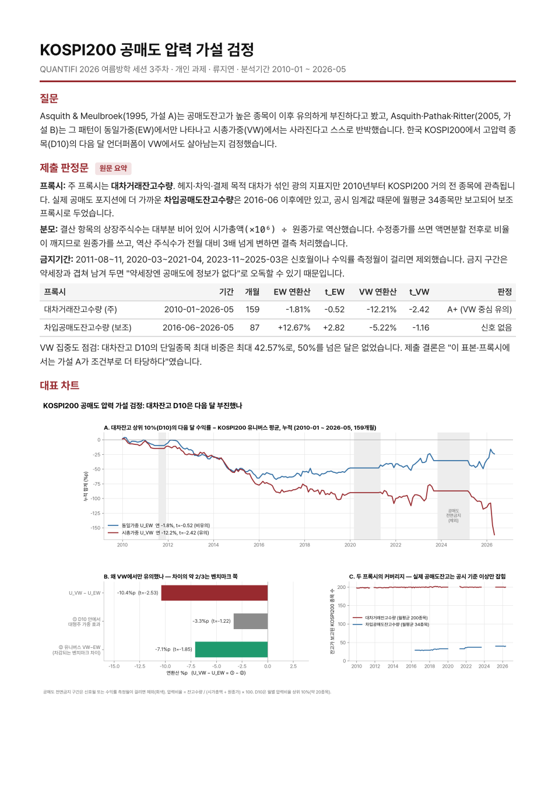
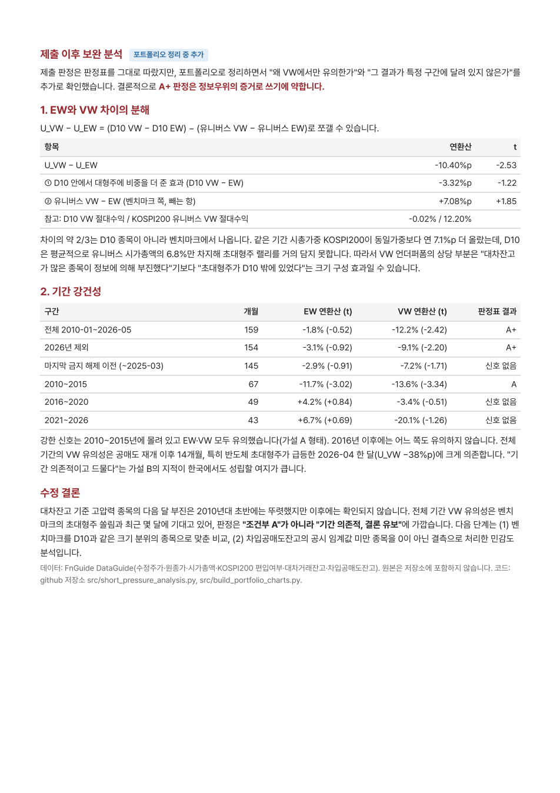
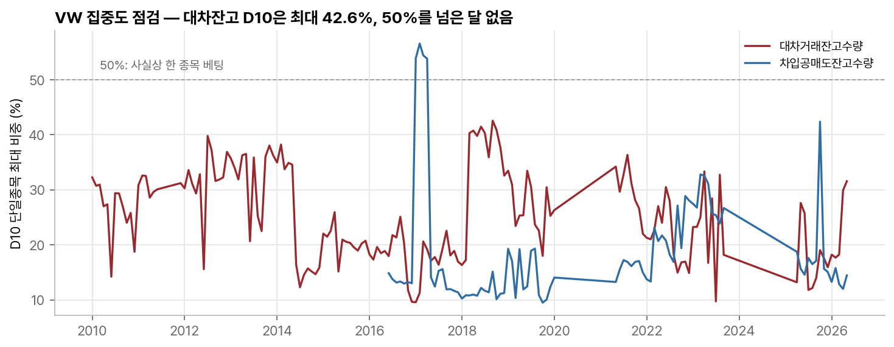

# 대차잔고가 많은 KOSPI200 종목은 다음 달 부진했나 — 공매도 압력 가설 검정 (2026 여름 · QUANTIFI 개인 과제)

> Asquith의 두 논문(1995 정보우위 vs 2005 자기반박) 중 무엇이 한국 KOSPI200에 맞는지 가려내는 가설 검정입니다. 제출 판정은 "VW에서만 유의 → 조건부 A(A+)"였지만, 포트폴리오로 정리하면서 다시 뜯어보니 **VW 유의성의 약 2/3가 벤치마크의 초대형주 쏠림에서 왔고, 2016년 이후로는 신호가 없었습니다.** 두 결과를 모두 남겼습니다.

[연구 요약 PDF 보기](docs/공매도압력_가설검정_연구요약.pdf) · [제출 판정문 원본(docx)](docs/final_judgement_제출본.docx) · [분석 노트북](notebooks/short_pressure_analysis.ipynb) · [분석 코드](src/short_pressure_analysis.py)

## 연구 질문

1. 공매도 압력(잔고 / 상장주식수)이 가장 높은 10%(D10)는 다음 달 KOSPI200 평균보다 부진한가?
2. 그 부진이 **시총가중(VW)에서도 살아남는가**, 아니면 가설 B(APR 2005)처럼 동일가중(EW)에서만 나타나는가?
3. 대차잔고와 실제 공매도잔고 중 무엇을 프록시로 써야 하고, 공매도 전면금지 기간은 어떻게 처리해야 하는가?

## 대표 차트

[](output/charts/hero_ew_vw_decomposition.png)

- **A:** 대차잔고 D10의 다음 달 초과수익 누적합. EW는 연 -1.8%(t=-0.52)로 비유의, VW는 연 -12.2%(t=-2.42)로 유의했습니다.
- **B:** VW와 EW의 차이 -10.4%p 중 D10 내부에서 대형주에 비중을 더 준 효과는 -3.3%p뿐이고, 나머지 -7.1%p는 **벤치마크(KOSPI200 VW가 EW보다 연 7.1%p 높았던 것)**에서 나왔습니다. D10은 평균적으로 유니버스 시가총액의 6.8%만 차지해 초대형주 랠리를 담지 못합니다.
- **C:** 실제 공매도잔고(차입공매도잔고수량)는 2016-06부터, 공시 임계값을 넘은 월평균 34종목만 보고됩니다. 대차잔고는 2010년부터 거의 전 종목이 관측됩니다.

## English summary

Do the KOSPI200 stocks under the heaviest **short-selling pressure** underperform the following month? (Summer 2026, individual QUANTIFI assignment.)

- **Hypotheses:** two Asquith papers. The 1995 paper argues short sellers are informed; the 2005 paper argues the effect is self-defeating.
- **Design:**
  - Pressure: stock-lending balance ÷ shares outstanding.
  - Portfolio: the top decile (D10) is formed at month-end *t*, and returns are measured in month *t+1*.
  - Sample: signal months 2010-01 – 2026-05, 159 valid months.
  - Short-sale ban periods are excluded.
- **Submitted verdict:** insignificant equal-weighted, significant value-weighted, so the conditional hypothesis (A+) was accepted.
- **Follow-up:** about two-thirds of the value-weighted significance came from the benchmark's mega-cap concentration, and there is no signal after 2016. Both results are kept; the conclusion is deferred as period-dependent.

## 한눈에 보기

| 항목 | 내용 |
| --- | --- |
| 유니버스·기간 | 월별 KOSPI200 편입 종목, 2010-01 ~ 2026-05 신호월 (유효 159개월) |
| 압력비율 | `잔고수량 / 상장주식수 × 100`, 상장주식수 = `시가총액(백만원 × 10⁶) / 원종가` |
| 데이터 이용 가능 시점 | 신호월 t의 월말 잔고·시총·원종가로 D10을 정하고, 수익률은 **t+1월**(forward)로 측정. 같은 달 수익률을 쓰면 공매도가 늘어 주가가 눌린 "동시성"을 예측력으로 착각하게 됨. 결산 항목의 상장주식수는 분기 갱신·공시 시차로 비어 있어 쓰지 않음 |
| 금지기간 처리 | 2011-08~11, 2020-03~2021-04, 2023-11~2025-03은 신호월 또는 측정월이 걸리면 제외 (대차 38개월 제외). 금지 구간이 약세장과 겹쳐, 남기면 "약세장엔 공매도에 정보가 없다"로 인과를 오독함 |
| 본인 역할 | 개인 과제. 프록시 선택, 분모 역산·분할 보정, 금지기간 처리, EW·VW 검정 코드, 판정문 작성, 제출 이후 보완 분석 모두 본인 |
| 제출 판정 | 대차잔고 기준 EW 비유의·VW 유의 → **A+ (VW 중심 유의)** |
| 보완 후 판단 | **기간 의존적, 결론 유보.** 신호는 2010~2015년에 몰려 있고 2016년 이후 비유의. 전체 VW 유의성은 공매도 재개 후 14개월과 벤치마크 구성에 크게 의존 |

## 왜 대차잔고와 실제 공매도잔고가 다른가

| | 대차거래잔고수량 (주 프록시) | 차입공매도잔고수량 (보조 프록시) |
| --- | --- | --- |
| 무엇을 세나 | 빌려준 주식 전체. 공매도 외에 헤지·차익거래·결제 목적 대차 포함 | 실제 순공매도 포지션 |
| 관측 시작 | 2010-01 | 2016-06 |
| KOSPI200 내 보고 종목 | 월평균 약 200종목 | 월평균 34종목 (상장주식수 대비 일정 비율 이상만 공시) |
| 장점 / 한계 | 매월 D10 20종목을 안정적으로 구성 / 정보와 무관한 대차가 섞인 광의 지표 | 정의가 정확 / 작은 포지션이 누락되는 검열 문제 |
| 결과 | EW -1.8% (t=-0.52), VW -12.2% (t=-2.42) | EW +12.7% (t=+2.82), VW -5.2% (t=-1.16) |

실제 공매도잔고는 보고되지 않은 종목을 0으로 채웠기 때문에, D10이 사실상 "공시 대상에 오른 종목 중 상위"가 되고 대부분의 종목은 같은 0 값으로 묶입니다. 보조 프록시의 EW가 오히려 양(+)으로 유의한 것은 이 검열 구조 때문일 가능성이 커서 판정 근거로 쓰지 않았습니다.

## 잘 안 된 결과와 그 해석

### 1. A+ 판정은 기간에 따라 사라진다

`output/tables/subperiod_robustness.csv`

| 구간 | 개월 | EW 연환산 (t) | VW 연환산 (t) | 판정표 결과 |
| --- | ---: | ---: | ---: | --- |
| 전체 2010-01~2026-05 | 159 | -1.8% (-0.52) | -12.2% (-2.42) | A+ |
| 2026년 제외 | 154 | -3.1% (-0.92) | -9.1% (-2.20) | A+ |
| 마지막 금지 해제 이전 (~2025-03) | 145 | -2.9% (-0.91) | -7.2% (-1.71) | 신호 없음 |
| 2010~2015 | 67 | -11.7% (-3.02) | -13.6% (-3.34) | A |
| 2016~2020 | 49 | +4.2% (+0.84) | -3.4% (-0.51) | 신호 없음 |
| 2021~2026 | 43 | +6.7% (+0.69) | -20.1% (-1.26) | 신호 없음 |

2010년대 초반에는 EW·VW 모두 유의한 전형적인 가설 A 형태였지만 이후에는 사라집니다. 전체 기간 VW 유의성은 반도체 초대형주가 급등한 2026년 4월 한 달(U_VW -38%p)을 포함한 최근 구간에 크게 기댑니다. APR(2005)이 말한 "기간 의존적이고 드물다"는 지적이 한국에서도 성립할 여지가 큽니다.

### 2. VW 결과는 "누가 D10 밖에 있었나"의 영향을 받는다

[](output/charts/u_vw_contribution_by_stock.png)

D10 안에서 비중이 큰 POSCO홀딩스(평균 32%), 셀트리온(30%), LG전자(13%)의 부진이 U_VW를 끌어내렸습니다. 여기에 D10 밖에 있던 초대형주가 유니버스 VW 수익률을 끌어올리는 효과가 더해졌습니다. 공정한 비교를 하려면 D10과 같은 크기 분위의 종목을 벤치마크로 써야 합니다(다음 단계).

### 3. 판정 자체를 바꾼 것은 아니다

제출 시점의 판정표 규칙(t < -2)을 그대로 적용하면 전체 기간 결과는 여전히 A+입니다. 여기서 바꾼 것은 **그 결과를 얼마나 믿을 수 있느냐에 대한 해석**이고, 사후에 기간을 골라 결론을 뒤집으려는 것이 아닙니다. 두 해석을 모두 [연구 요약 PDF](docs/공매도압력_가설검정_연구요약.pdf)에 나란히 적었습니다.

## 연구 요약 PDF

이미지를 클릭하면 PDF 원본이 열립니다. 1쪽은 제출 판정문 요약, 2쪽은 제출 이후 보완 분석입니다.

<table>
  <tr>
    <td width="50%"><a href="docs/공매도압력_가설검정_연구요약.pdf"></a></td>
    <td width="50%"><a href="docs/공매도압력_가설검정_연구요약.pdf"></a></td>
  </tr>
</table>

## 방법

```math
\mathrm{Pressure}_{i,t} = \frac{\mathrm{Balance}_{i,t}}{\mathrm{MCAP}_{i,t}\times 10^{6} / P^{\mathrm{raw}}_{i,t}} \times 100
```

```math
U^{EW}_t = \frac{1}{|D10_t|}\sum_{i\in D10_t} r_{i,t+1} - \frac{1}{|U_t|}\sum_{i\in U_t} r_{i,t+1},
\qquad
U^{VW}_t = \frac{\sum_{i\in D10_t} w_{i,t} r_{i,t+1}}{\sum_{i\in D10_t} w_{i,t}} - \frac{\sum_{i\in U_t} w_{i,t} r_{i,t+1}}{\sum_{i\in U_t} w_{i,t}}
```

연환산 평균은 `mean(U) × 12`, t값은 `mean(U) / (std(U) / √N)`입니다. 판정표는 t < -2를 유의로 봅니다: EW·VW 모두 유의 = A, EW만 = B, VW만 = A+, 둘 다 아님 = 신호 없음.

- **분할 보정:** 수정종가를 분모에 쓰면 액면분할 전후로 비율이 깨지므로 원종가를 쓰고, 역산 주식수가 전월 대비 3배 초과로 변하면 그 종목-월을 결측 처리했습니다.
- **단위 확인:** 시가총액이 백만원 단위라 ×10⁶을 하지 않으면 압력비율이 수백만 %가 됩니다. 정상 범위(중앙값 수 %, 상위 10%대)인지 확인했습니다.
- **VW 집중도:** D10이 20종목뿐이라 한 종목이 50%를 넘으면 사실상 한 종목 베팅입니다. 대차잔고 D10은 최대 42.6%로 50%를 넘은 달이 없었고, 실제 공매도잔고 D10은 삼성전자 비중이 50%를 넘은 달이 4번 있었습니다.

[](output/charts/d10_max_weight.png)

## 폴더 구성

| 경로 | 내용 |
| --- | --- |
| `src/short_pressure_analysis.py` | 원본 Excel → 압력비율 → 월별 D10 → U_EW·U_VW·t → 판정 |
| `src/build_portfolio_charts.py` | README 차트, EW·VW 차이 분해, 기간 강건성, 종목별 기여 (제출 수치와 일치하는지 assert로 확인) |
| `src/create_submission_artifacts.py` | 제출용 노트북·판정문 docx 생성 |
| `notebooks/short_pressure_analysis.ipynb` | 제출 노트북 |
| `output/tables/` | 프록시별 검정 요약, 월별 언더퍼폼, D10 최대 비중, 제외 월, 분해·강건성·기여 표 |
| `docs/` | 연구 요약 PDF(와 HTML 원본), 제출 판정문 docx, 미리보기 이미지 |
| `sample_data/`, `scripts/generate_sample_data.py` | 원본 시트 구조를 흉내 낸 합성 데이터 |

## 재실행

```bash
pip install -r requirements.txt
python src/short_pressure_analysis.py   # input/raw_data/ 원본 Excel 필요
python src/build_portfolio_charts.py
```

원본(FnGuide DataGuide)은 공개하지 않으며, 저장소에는 코드·합성 샘플·파생 결과만 포함합니다.

## 한계

- 원논문과 달리 기관보유비중(공급 프록시)을 쓰지 않고 공매도 압력만으로 축소한 검정입니다.
- 대차잔고는 공매도 외 목적의 대차를 포함하는 광의 프록시입니다.
- KOSPI200은 200종목뿐이라 D10이 20종목이고 검정력이 제한적입니다.
- 거래비용·공매도 비용은 고려하지 않았습니다(매매 전략이 아니라 가설 검정).
